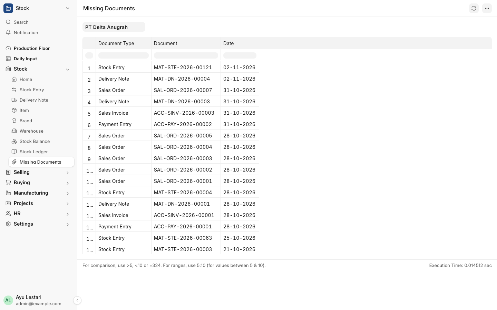
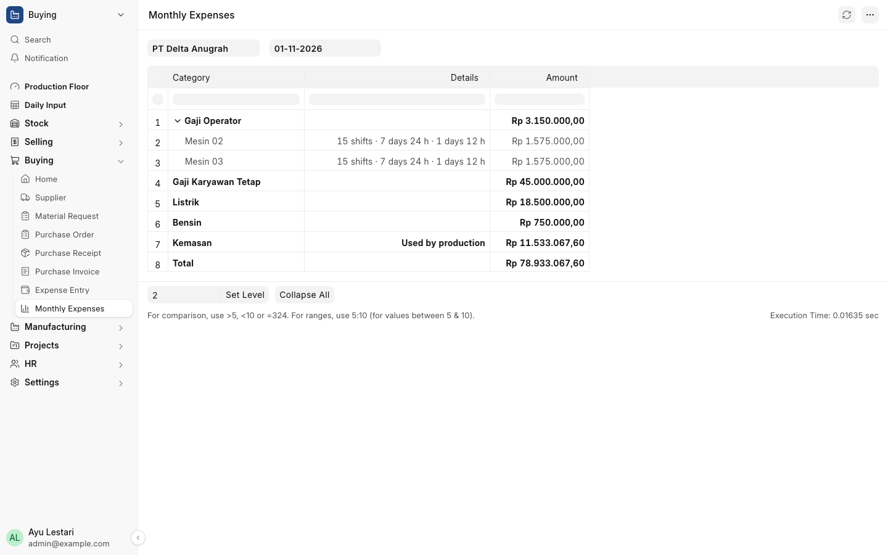

# Panduan Admin

Untuk **Admin**. Admin melihat hasil produksi yang dicatat Produksi (`user.md`; mengisinya tidak bisa), dan
mengerjakan: perintah produksi (Work Order), surat jalan dan bahan masuk (`gudang.md`), barang, pemasok, resep
(BOM), stok awal dan stok opname, HR, akun pengguna, dan pengaturan usaha. Akun pengguna, stok awal dan opname, dan
pengaturan ada di menu **Settings** di kiri; barang, pemasok dan BOM di modulnya (Stock, Buying,
Manufacturing); HR di menu **HR**.

Ada tiga peran (**Role Profile**):

| Peran | Untuk siapa | Bisa |
|---|---|---|
| **Produksi** | orang pabrik | cuma mencatat hasil produksi dan status mesin; lihat Work Order, Machine Capacity, Plan vs Actual (`user.md`) |
| **Admin** | pemilik dan kepala | lihat hasil produksi; Work Order, BOM, stok, surat jalan, data induk, penjualan, pembelian, proyek, HR, akun pengguna, pengaturan usaha |
| **Super Admin** | tim IT | semuanya kecuali modul yang dikunci, termasuk Build, System Settings, dan **Finish** di Work Order |

Ganti bahasa: klik nama kamu di pojok kiri bawah menu samping, pilih **Bahasa Indonesia**. Nama tombol di sini ditulis seperti
di tampilan bahasa Inggris.

Modul yang tidak dipakai (CRM, Assets, Quality, Support, Payroll, dan lain-lain) dikunci, begitu juga bagian HR yang
tidak dipakai (rekrutmen, penilaian kinerja, training, klaim biaya, perjalanan dinas, lembur, dan lain-lain; absen,
shift dan cuti tetap jalan): tidak ada di menu, tidak
muncul di pencarian, dan tidak bisa dibuka lewat alamat. Kalau suatu hari dibutuhkan, tim IT membukanya
(hapus dari daftar di kode, lalu migrate).

Versi aplikasi (misalnya `v0.0.1`) ada di bawah kotak login dan di bagian bawah menu kiri **My Settings**. Sebut
versinya kalau melaporkan masalah.

## Rekap harian: cetak dan Excel
Halaman **Daily Input** (menu paling atas, di bawah Production Floor) bisa dibaca Admin tanpa kotak isian. Tombol
**Print** membuka rekap minggu yang tampil sebagai halaman cetak (A4 mendatar) di jendela baru; tombol **Excel**
mengunduh `input-harian-<dari>-<sampai>.xlsx`, satu sheet dengan susunan lembar Excel Samuel. Cara bacanya ada di
`produksi.md` "Input harian".

## Dokumen asli dilampirkan

Dokumen kertas harus ada foto atau scan-nya sebelum di-Submit: Sales Order, Sales Invoice, Purchase Order, Purchase
Receipt, Purchase Invoice, Payment Entry, Stock Entry **Material Receipt**, dan Expense Entry **Once**. Tanpa lampiran, sistem menolak
("Attach a photo or scan of the real document before you submit.") dan formnya menampilkan catatan oranye. Catatan
produksi (Production Entry, Work Order, BOM, Stock Entry Manufacture dan Repack), stok opname, dan Delivery Note
tidak diwajibkan; surat jalan dilampiri setelah ditandatangani. Dokumen hasil Amend membawa lampirannya; dokumen yang
dibuat dari dokumen lain (Sales Order ke Delivery Note, Purchase Order ke Purchase Receipt) mulai tanpa lampiran.

Laporan **Stock → Missing Documents** menampilkan dokumen yang sudah di-Submit tapi belum ada lampirannya, plus semua
surat jalan yang belum dilampiri. Tindak lanjutnya dari situ.

## Biaya bulanan

Menu **Buying → Expense Entry** mencatat biaya pabrik; cuma Admin dan Super Admin yang bisa membuka dan melihatnya.
Isi **Date**, **Category** (Gaji Operator, Gaji Karyawan Tetap, Listrik, Bensin, Lainnya; kategori baru bisa
ditambah di Expense Category), **Amount** (Rupiah), dan **Repeat**:

| Repeat | Dihitung di bulan | Lampiran |
|---|---|---|
| **Once** | bulan tanggalnya | wajib (nota, kuitansi) |
| **Every month** | tiap bulan dari bulan tanggalnya sampai bulan **Until** | tidak |
| **Per machine shift** | Amount x jumlah shift mesin dari tanggalnya sampai **Until** | tidak |

Satu shift mesin = satu mesin yang punya hasil produksi di satu tanggal dan satu shift; dua Work Order di mesin yang
sama di shift yang sama dihitung satu. **Until** (hari terakhir yang dihitung) boleh diisi setelah Submit; kosong
berarti masih berjalan. Dua biaya Per machine shift dengan kategori yang sama tidak boleh bertumpuk waktunya
("End the earlier one first"). Gaji naik: isi Until di catatan lama, lalu buat catatan baru mulai hari berikutnya,
jadi bulan lalu tetap pakai tarif lama.

Laporan **Buying → Monthly Expenses** (pilih Company dan Month, tanggal mana saja di bulan itu) menampilkan satu baris
per kategori dan Total. Di bawah Gaji Operator ada satu baris per mesin: jumlah shift, hari 24 jam (dua shift), dan
hari 12 jam (satu shift).

Dua baris dihitung sendiri, tanpa Expense Entry: **Pigmen** dan **Kemasan** ("Used by production"), yaitu nilai stok
pigmen dan kemasan yang dipakai hasil produksi bulan itu (Production Entry yang di-Submit; reject ikut memakai pigmen, tidak memakai kemasan),
dengan harga stoknya. Yang dihitung pemakaian, bukan pembelian: beli banyak sekaligus tidak jadi biaya satu bulan.
Barisnya muncul kalau nilainya tidak nol, dan ikut Total.

**Saat go-live** Admin membuat satu catatan: Category **Gaji Operator**, Amount **105.000**, Repeat **Per machine
shift**, Date = hari produksi pertama, lalu Submit.

## Kemasan per produk

Di form barang produk (template atau varian, grup Barang Jadi), tabel **Packing** berisi kemasan yang dipakai:
**Packing Item** (barang grup **Kemasan**, misalnya plastik isi 560) dan **Pieces per Packing** (berapa buah muat
dalam satu kemasan, lebih dari 0). Isi di template berlaku untuk semua variannya; varian yang punya baris sendiri
memakai barisnya sendiri. Setelah Save, BOM kapasitas dibuat ulang di belakang layar (sama seperti pigmen), jadi
tiap buah hasil produksi memakai 1 / Pieces per Packing kemasan. Barang kemasan dibuat di **Stock → Item → + Add
Item** dengan Item Group **Kemasan** dan Default Unit of Measure **Buah** (satuan yang boleh pecahan; kemasan
bersatuan Pcs ditolak di tabel Packing); menonaktifkan barang kemasan juga
membuat ulang BOM tanpa baris itu.

Stok dulu: terima barang kemasan di **Gudang Bahan Baku** (Material Receipt, `gudang.md`) sebelum mengisi tabel
Packing sebuah produk. Kalau stoknya belum ada, pencatatan hasil produksi produk itu gagal (stok tidak boleh minus);
setelah Save, sistem memberi catatan oranye kalau kemasannya belum ada stok di Gudang Bahan Baku.

## Data belum lengkap

Selama data belum lengkap, aplikasi tetap jalan, tapi ada yang tidak dihitung. Supaya kelihatan, ada catatan oranye
di form, dan semuanya terkumpul di laporan **Settings → Missing Data** (cuma Admin dan Super Admin). Tiap catatan
punya link (tulisan tebal bergaris bawah) yang langsung membuka tempat membetulkannya.

| Yang belum ada | Akibatnya | Link membuka |
|---|---|---|
| Kemasan produk (tabel Packing) | kemasan tidak ikut terpakai, biayanya tidak dihitung | form barang, langsung di tabel Packing |
| Pigmen untuk suatu warna | produk warna itu tidak memakai pigmen, biayanya tidak dihitung | template PIGMEN dengan jendela Create Variant, warnanya sudah terisi |
| Harga jual di daftar harga bawaan | baris Sales Order mulai dari 0 | Item Price baru, barang dan daftar harganya sudah terisi |
| Biaya Gaji Operator yang berjalan | gaji operator tidak dihitung di Biaya Bulanan | Expense Entry baru: Gaji Operator, Per machine shift |
| Kapasitas mesin produk | semua mesin boleh dipakai, Plan vs Actual tanpa target | Machine Capacity baru untuk barang itu |
| Stok pigmen atau kemasan di Gudang Bahan Baku | pencatatan hasil produksi gagal | Purchase Order baru dengan barangnya |

Warna Bening, Bening Transparan dan Campur memang tanpa pigmen, jadi tidak dicatat. Catatan di form: form barang
(yang kurang dari barang itu), Sales Order draft ("Line 1: ... has no selling price."), Work Order yang belum
selesai (kemasan atau pigmen belum ada), dan laporan Monthly Expenses (gaji operator). Catatan tidak pernah menahan
Save. Di laporan, kolom **Item** menyaring ke satu barang dan variannya.

## Akun pengguna

### Tambah orang
1. **Settings → Users → + Add User**.
2. Isi **Email** dan **First Name**, lalu **Role Profiles**: `Produksi` atau `Admin`. **Save**.
3. Di formnya: **Module Profile** sama dengan perannya (`Produksi` atau `Admin`). **Save**.
4. Kalau dia ikut absen: buat **Employee** dengan **User ID** = email ini (`docs/panduan/absen.md`, Karyawan baru).

### Nonaktifkan atau ganti sandi
- Keluar kerja: buka usernya, hilangkan centang **Enabled**, **Save**. Datanya tetap ada.
- Lupa sandi: buka usernya, **Password → Reset Password** (link dikirim ke email), atau isi **Set New Password**
  di bagian Change Password, lalu **Save**.

### Yang tidak bisa
Admin hanya bisa memberi peran **Produksi** atau **Admin**. Peran **Super Admin**, **System Manager**, atau peran lain
ditolak sistem ("You cannot give these roles"), juga untuk akun sendiri. Akun Super Admin dan Administrator tidak
bisa diubah Admin ("Only a Super Admin can change this account").

## Pengaturan usaha

Di **Settings**: **Company**, **Opening Stock & Stock Count** (Stock Reconciliation: stok awal dan stok
opname, `docs/panduan/gudang.md`), **Stock Settings**, **Selling Settings**, **Buying Settings**, **Manufacturing
Settings**, **Accounts Settings**, **Projects Settings**, **HR Settings**, dan laporan **Missing Data** (di atas). Ubah hanya kalau tahu akibatnya; sistem
sudah diatur (pesanan dulu baru terima barang (pembelian); surat jalan boleh langsung; stok tidak boleh minus) dan setelan itu dipasang lagi tiap
pembaruan.

Perusahaan tidak PKP: template PPN ada, tapi tidak dipakai bawaan. Faktur hanya untuk mencatat.
