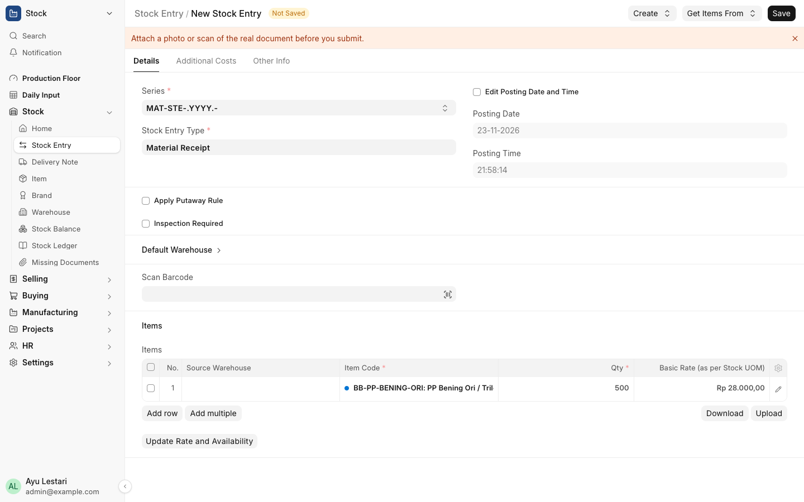
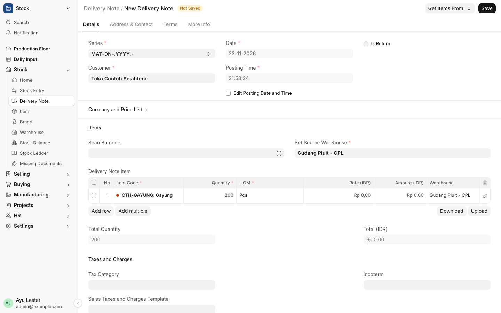
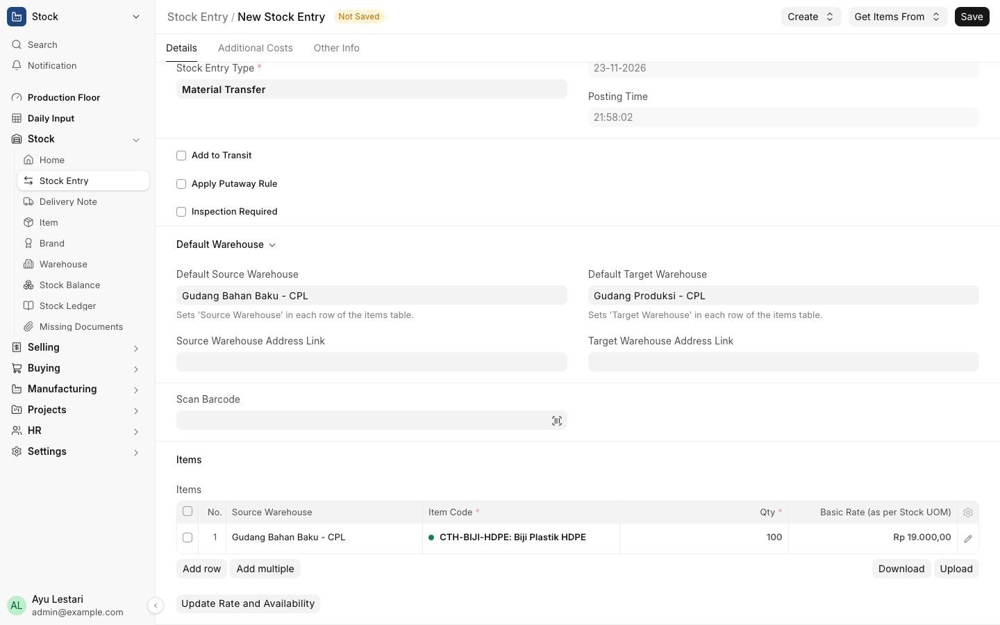

# Panduan Gudang

Untuk **Admin**: bahan baku masuk, surat jalan, pindah gudang dan stok opname (Stock Reconciliation). Akun
**Produksi** tidak membuka menu Stock (Mas Samuel, 2026-11-23). Pabrik punya lima gudang:

| Gudang | Isinya |
|---|---|
| Gudang Bahan Baku | biji plastik, pewarna, bahan penolong |
| Gudang Produksi | bahan yang sedang dipakai di mesin |
| Gudang Barang Jadi | produk siap kirim |
| Gudang Reject | produk cacat |
| Gudang Pluit | produk siap kirim yang disimpan di Pluit |

Barang yang dijual diambil dari Gudang Barang Jadi atau Gudang Pluit. Laporan Order Readiness menjumlahkan stok
keduanya.

Stok tidak boleh minus: kalau sistem bilang stok kurang, cek dulu barangnya, jangan dipaksa.

Ganti bahasa: klik nama kamu di pojok kiri bawah menu samping, pilih **Bahasa Indonesia**. Nama tombol di sini ditulis seperti
di tampilan bahasa Inggris.

## Harian

### Terima bahan baku
Purchase Order dipakai Admin sejak 2026-11-23 (Mas Samuel: PO dan Sales Order, cetak format PO Samuel;
`pembelian.md`). Bahan yang masuk tanpa pesanan dicatat langsung:
1. **Stock → Stock Entry → + Add Stock Entry**, **Stock Entry Type** `Material Receipt`.
2. **Default Target Warehouse**: `Gudang Bahan Baku`.
3. Di **Items**: bahan (misalnya biji plastik) dan jumlahnya dalam Kg. **Save**.
4. **Attach** foto atau scan surat jalan dari pemasok (di kanan form). Tanpa lampiran, **Submit** ditolak dan form
   menampilkan catatan oranye.
5. **Submit**: stok bertambah.

Seal Cap: sebelum hasil produksinya dicatat, `BB-SEAL-CAP` (Kg), pigmen warnanya (Gram), `Plastik 35x50` atau
`Plastik 30x45` dan `Karung` (Buah) harus sudah ada stoknya di Gudang Bahan Baku; kalau belum, pencatatan ditolak.

### Kirim barang ke pelanggan
Sales Order dipakai Admin sejak 2026-11-23 (Mas Samuel: PO dan Sales Order, cetak format PO Samuel). Surat
jalan boleh tetap langsung tanpa Sales Order:
1. **Stock → Delivery Note → + Add Delivery Note**.
2. **Customer**: pelanggannya (pelanggan baru dibuat Admin).
3. **Set Source Warehouse** (wajib): pilih `Gudang Barang Jadi` atau `Gudang Pluit`, sesuai tempat barangnya
   diambil. Semua baris barang ikut gudang itu. Kosong berarti tidak bisa di-Save.
4. Di **Items**: barang dan jumlah. **Save**, lalu **Submit** sebelum truk berangkat: stok langsung berkurang.
   Cetak: **Print**.

Stok tidak cukup? Sistem menolak Submit. Cek stoknya dulu; stok tidak boleh minus.

Surat jalan boleh di-Submit tanpa lampiran, supaya truk tidak menunggu. Setelah pelanggan menandatangani, buka
suratnya dan **Attach** foto surat jalan yang sudah ditandatangani (bisa setelah Submit). Formnya menampilkan catatan
oranye "Attach the signed delivery note." selama belum ada.

### Surat yang belum dilampiri
**Stock → Missing Documents** (Admin dan Super Admin): daftar dokumen yang sudah di-Submit tapi belum ada foto atau
scan-nya (semua surat jalan, plus pesanan, faktur, penerimaan dan pembayaran), yang terbaru di atas. Klik
dokumennya, **Attach**, dan hilang dari daftar.

### Pindah barang antar gudang
1. **Stock → Stock Entry → + Add Stock Entry**, **Stock Entry Type** `Material Transfer`.
2. Isi **Default Source Warehouse** dan **Default Target Warehouse** (misalnya Bahan Baku ke Produksi, atau
   Barang Jadi ke Pluit kalau barang jadi dipindah ke Pluit).
3. Di **Items**: barang dan jumlah. **Save**, **Submit**.

### Lihat stok
- Stok sekarang per gudang: **Stock → Stock Balance**.
- Riwayat keluar masuk satu barang: **Stock → Stock Ledger**, saring **Item**.

## Bulanan: stok opname

1. Hitung fisik.
2. **Settings → Opening Stock & Stock Count → + Add Stock Reconciliation**, **Purpose** `Stock Reconciliation`.
3. Isi per baris: barang, gudang, **Quantity** hasil hitung. **Save**, **Submit**: sistem menyamakan stoknya.

Selisih besar? Laporkan dulu ke atasan sebelum Submit.
