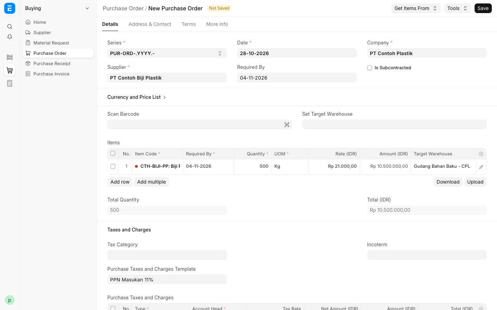
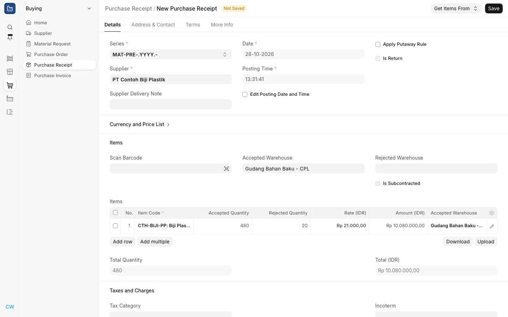

# Panduan Pembelian

> **Dipakai Admin sejak 2026-11-23** (Mas Samuel: PO dan Sales Order, cetak format PO Samuel). Surat jalan boleh
> tetap langsung tanpa Sales Order (`gudang.md`). Cuma **Admin** yang bisa membuka menu Buying.

Untuk **Admin**. Urutannya: **Material Request → Purchase Order → Purchase Receipt → Purchase Invoice**.
Barang tidak bisa diterima tanpa Purchase Order; sistem menolaknya.

Ganti bahasa: klik nama kamu di pojok kiri bawah menu samping, pilih **Bahasa Indonesia**. Nama tombol di sini ditulis seperti
di tampilan bahasa Inggris.

## 1. Lihat permintaan barang (Material Request)

Yang pegang produksi atau gudang membuat **Material Request** kalau bahan mau habis. Buka **Buying → Material Request**,
saring yang statusnya **Pending**.

## 2. Pesan ke pemasok (Purchase Order)

1. Dari Material Request: **Create → Purchase Order**. Atau langsung **Buying → Purchase Order → + Add Purchase Order**.
2. Isi **Supplier** dan **Required By** (tanggal barang harus datang).
3. Di **Items**: barang, **Quantity**. **Rate** (harga per kg, kemasan per buah) terisi sendiri dari daftar harga `Harga Bahan Baku`;
   ubah kalau harga supplier beda. Rate 0 berarti bahan itu belum punya harga di daftar. Gudang tujuan bahan baku:
   **Gudang Bahan Baku**.
4. **Purchase Taxes and Charges Template** dibiarkan kosong: perusahaan tidak PKP.
5. **Save**, **Attach** foto atau scan dokumen aslinya (PO yang dicap atau dikirim), lalu **Submit**: tanpa
   lampiran sistem menolak. Kirim ke pemasok: **Print** (format PO Samuel Beli: tabel NO., ORDER, QTY, SATUAN,
   TGL KIRIM, HARGA dan kotak TOTAL merah, tanggal kirim dari **Required By**) atau **Email**.

**Pigmen** dibeli per **Kg** (satuan beli bawaannya Kg) tapi distok dalam **gram**: pesan `2` Kg, stok bertambah
2.000 g. Harga per Kg diisi di daftar harga `Harga Bahan Baku` (**Buying → Item Price**, **UOM** `Kg`).
Pigmen dan kemasan harus sudah ada stoknya di **Gudang Bahan Baku** sebelum Produksi mencatat hasil produk
yang memakainya, kalau tidak pencatatan gagal (`produksi.md` "Pigmen", `admin.md` "Kemasan per produk").

**Kemasan** (plastik, karung, karton) dibeli seperti bahan baku: barang grup **Kemasan**, satuan **Buah**, gudang
bawaannya Gudang Bahan Baku, harganya di `Harga Bahan Baku`. Stoknya berkurang lewat BOM saat hasil produksi dicatat
(`produksi.md` "Kemasan"), dan pemakaiannya muncul di laporan Monthly Expenses (`admin.md`).

## 3. Terima barang (Purchase Receipt)

Biasanya dikerjakan Gudang saat truk datang.

1. Di Purchase Order: **Create → Purchase Receipt**.
2. Ubah **Quantity** ke jumlah yang benar-benar datang. Barang rusak: isi **Rejected Quantity**.
3. **Save**, **Attach** foto atau scan surat jalan dari pemasok, lalu **Submit**: stok gudang langsung bertambah.
   Dokumen yang dibuat dari Purchase Order mulai tanpa lampiran, jadi lampirkan lagi.

## 4. Catat tagihan pemasok (Purchase Invoice)

1. Di Purchase Receipt: **Create → Purchase Invoice**.
2. Samakan nomor dan tanggal dengan faktur pemasok (**Supplier Invoice No**, **Supplier Invoice Date**).
3. **Save**, **Attach** foto atau scan faktur pemasok, lalu **Submit**. Bayarnya nanti lewat **Create → Payment**
   (lampirkan juga bukti bayarnya sebelum Submit).

## Kalau salah

Sudah Submit: **Cancel**, lalu **Amend**. Batalkan dari yang paling akhir dulu.
