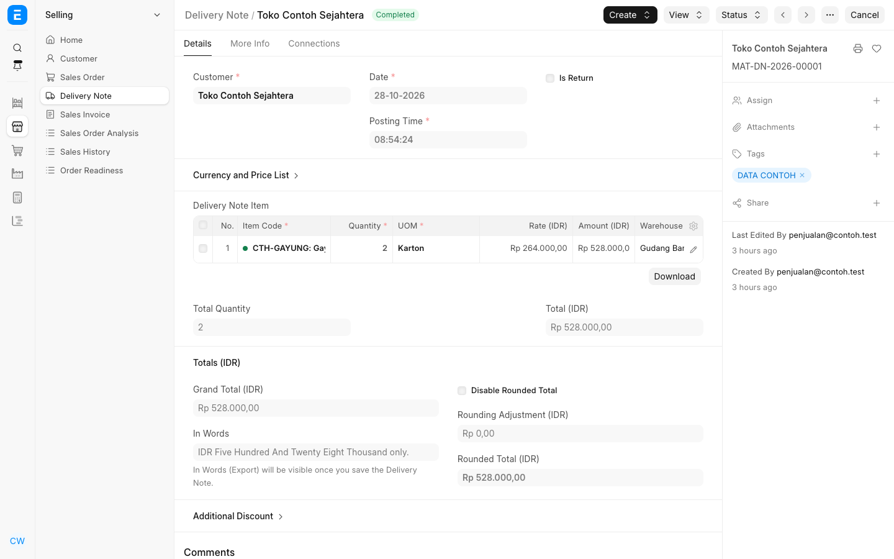

# Panduan Penjualan

Untuk **User** dan **Admin**. Urutannya selalu: **Sales Order → Delivery Note → Sales Invoice → Payment Entry**.
Surat jalan dan faktur tidak bisa dibuat tanpa pesanan; sistem menolaknya.

Tampilan aslinya bahasa Inggris. Mau bahasa Indonesia: klik nama kamu di pojok kanan atas, pilih
**Bahasa Indonesia**. Nama tombol di panduan ini ditulis seperti di tampilan bahasa Inggris.

## 1. Catat pesanan pelanggan (Sales Order)

1. Buka **Selling → Sales Order → + Add Sales Order**.
2. Isi **Customer**, **Delivery Date** (tanggal kirim yang dijanjikan).
3. Di tabel **Items**: pilih barang, isi **Quantity** dan **Rate** (harga satuan).
   Kalau pelanggan pesan per karton, pilih **UOM** `Karton`; sistem menghitung isinya sendiri.
4. Klik **Save**, cek lagi, lalu **Submit**. Pesanan yang belum di-Submit belum dihitung.

## 2. Kirim barang (Delivery Note)

1. Di Sales Order yang sudah Submit: **Create → Delivery Note**.
2. Cek jumlah yang benar-benar dikirim hari ini (boleh sebagian; sisanya tetap di pesanan).
3. Gudang asalnya otomatis **Gudang Barang Jadi**. **Save**, lalu **Submit**: stok langsung berkurang.
4. Cetak surat jalan: **Print**.

Stok tidak cukup? Sistem menolak Submit. Cek stoknya dulu; stok tidak boleh minus.

## 3. Tagih pelanggan (Sales Invoice)

1. Di Delivery Note yang sudah Submit: **Create → Sales Invoice**.
2. Faktur cuma untuk mencatat (perusahaan tidak PKP): **Sales Taxes and Charges Template** dibiarkan kosong.
3. **Save**, cek totalnya, lalu **Submit**. Cetak dengan **Print**.

## 4. Catat pembayaran (Payment Entry)

1. Di Sales Invoice: **Create → Payment**.
2. Isi tanggal dan jumlah yang diterima, pilih rekening atau kas. **Save**, lalu **Submit**.

## Kalau salah

- Belum Submit: ubah saja, lalu **Save**.
- Sudah Submit: **Cancel**, lalu **Amend** untuk membuat versi yang benar. Batalkan dari yang paling akhir dulu
  (pembayaran, faktur, surat jalan, baru pesanan).
