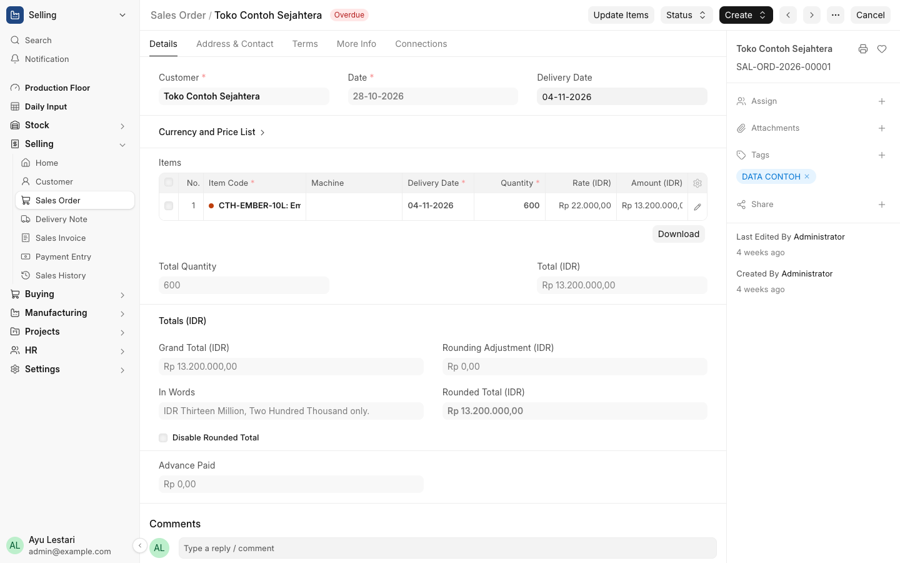
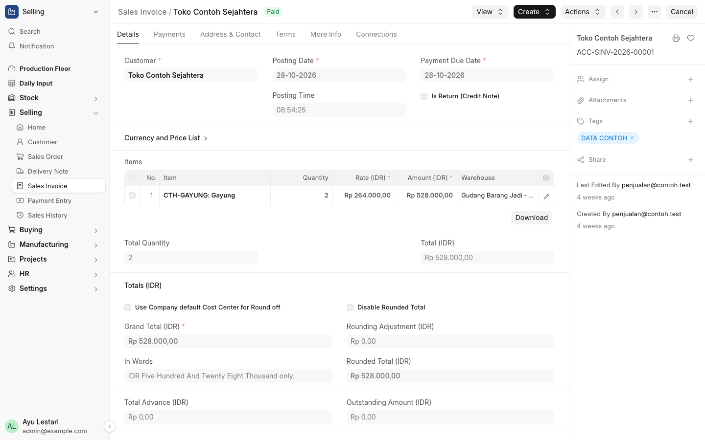

# Panduan Penjualan

> **Dipakai Admin sejak 2026-11-23** (Mas Samuel: PO dan Sales Order, cetak format PO Samuel). Surat jalan boleh
> tetap langsung tanpa Sales Order (`gudang.md`). Cuma **Admin** yang bisa membuka menu Selling.

Untuk **Admin**. Urutannya: **Sales Order → Delivery Note → Sales Invoice → Payment Entry**.

Tampilan aslinya bahasa Inggris. Mau bahasa Indonesia: klik nama kamu di pojok kiri bawah menu samping, pilih
**Bahasa Indonesia**. Nama tombol di panduan ini ditulis seperti di tampilan bahasa Inggris.

## 1. Catat pesanan pelanggan (Sales Order)

1. Buka **Selling → Sales Order → + Add Sales Order**.
2. Isi **Customer**, **Delivery Date** (tanggal kirim yang dijanjikan).
3. Di tabel **Items**: pilih barang, isi **Quantity**. **Rate** (harga satuan) terisi sendiri dari daftar harga
   `Harga Pola 2026`; ubah kalau harganya beda. Rate 0 berarti barang itu belum punya harga di daftar: form
   menampilkan catatan oranye ("Line 1: ... has no selling price.") dengan link **Add a selling price** yang
   langsung membuka harga baru untuk barang itu (`admin.md` "Data belum lengkap").
   Kalau pelanggan pesan per karton, pilih **UOM** `Karton`; sistem menghitung isinya sendiri.
   **Seal Cap** (pelanggan PT. Empat Putra Pangestu): pilih juga **Machine** di baris itu (daftarnya hanya Mesin 04 dan Mesin 14). Harganya ikut mesin:
   Mesin 04 = Rp24, Mesin 14 = Rp23 per pcs, terisi sendiri begitu mesinnya dipilih (dan dihitung ulang saat
   Save). Baris Seal Cap tanpa mesin ditolak saat Save ("pick the machine, the price follows it"). Diskon atau
   margin per baris tidak berlaku untuk Seal Cap (dihapus saat Save); kalau perlu potongan, isi diskon di level
   pesanan (**Additional Discount** di bawah tabel). Sesudah Submit, **Update Items** tidak bisa mengubah harga
   Seal Cap (ditolak "on Mesin 04 the price is 24"); jumlahnya boleh diubah. Work Order yang
   dibuat dari Sales Order ini ikut memakai mesin baris itu, dan cetakan PO menulis mesinnya dengan merah setelah
   nama barang (" - Mesin 04").
4. Klik **Save**, cek lagi. **Lampirkan foto atau scan dokumen aslinya** (pesanan dari pelanggan) lewat
   **Attach** di kanan form; selama belum ada lampiran, form menampilkan catatan oranye dan **Submit** ditolak.
5. Klik **Submit**. Pesanan yang belum di-Submit belum dihitung.
6. Cetak: **Print**. Hasilnya langsung format PO Samuel (tabel NO., ORDER, QTY, SATUAN, TGL KIRIM, HARGA dan kotak
   TOTAL merah). Nomor di atasnya adalah **Customer's Purchase Order** kalau diisi, kalau kosong nomor Sales Order.

## 2. Kirim barang (Delivery Note)

1. Di Sales Order yang sudah Submit: **Create → Delivery Note**.
2. Cek jumlah yang benar-benar dikirim hari ini (boleh sebagian; sisanya tetap di pesanan).
3. Cek **Set Source Warehouse** (wajib): `Gudang Barang Jadi` atau `Gudang Pluit`, sesuai tempat barangnya diambil.
   **Save**, lalu **Submit**: stok langsung berkurang.
4. Cetak surat jalan: **Print**.
5. Surat jalan boleh di-Submit tanpa lampiran. Setelah pelanggan menandatangani, lampirkan fotonya lewat **Attach**
   (bisa setelah Submit). Yang belum dilampiri muncul di laporan **Stock → Missing Documents**.

Stok tidak cukup? Sistem menolak Submit. Cek stoknya dulu; stok tidak boleh minus.

## 3. Tagih pelanggan (Sales Invoice)

1. Di Delivery Note yang sudah Submit: **Create → Sales Invoice**.
2. Faktur cuma untuk mencatat (perusahaan tidak PKP): **Sales Taxes and Charges Template** dibiarkan kosong.
3. **Save**, cek totalnya, **Attach** foto atau scan fakturnya, lalu **Submit** (tanpa lampiran ditolak). Cetak
   dengan **Print**.

## 4. Catat pembayaran (Payment Entry)

1. Di Sales Invoice: **Create → Payment**.
2. Isi tanggal dan jumlah yang diterima, pilih rekening atau kas. **Save**, **Attach** bukti pembayarannya (foto atau scan), lalu **Submit**.

## Kalau salah

- Belum Submit: ubah saja, lalu **Save**.
- Sudah Submit: **Cancel**, lalu **Amend** untuk membuat versi yang benar. Batalkan dari yang paling akhir dulu
  (pembayaran, faktur, surat jalan, baru pesanan).
