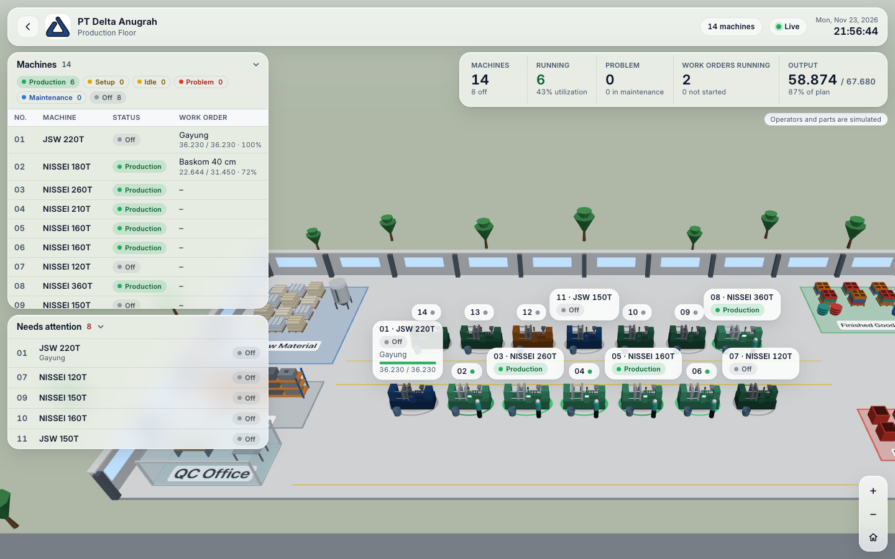

# Panduan Produksi

Untuk **User** dan **Admin**; lama produksi (Item Lead Time) diisi **Admin**. **Sales History** juga
ada di menu **Selling**.
Alurnya:

1. sekali per produk: **lama produksi** dan **resep (BOM)**;
2. tiap bulan: **perkiraan penjualan → jadwal produksi → MRP → perintah produksi**;
3. tiap shift: **catat hasil produksi** per mesin (bagus dan reject);
4. tiap Senin: cek **Order Readiness** (Siap Order).

Ganti bahasa: klik nama kamu di pojok kanan atas, pilih **Bahasa Indonesia**. Nama tombol di sini ditulis seperti
di tampilan bahasa Inggris.

> Gambar layar lainnya menyusul (lihat `docs/TODO.md`).

## Lantai produksi (Production Floor)

Lihat 14 mesin injeksi sekaligus, sebagai gambar 3D, dan statusnya saat ini. Buka dari **Manufacturing → Production
Floor** (pilihan paling atas).

- **Warna lampu mesin**: hijau = jalan (Production), merah berkedip = Problem, biru dan agak gelap = Maintenance,
  mati dan lebih gelap = Off. Di atas tiap mesin ada nama dan Work Order yang sedang jalan.
- **Lihat dari sudut lain**: tarik pakai mouse untuk memutar, scroll untuk zoom, klik kanan lalu tarik untuk
  menggeser. Tombol **+**, **−** dan **rumah** (pojok kanan bawah) zoom dan mengembalikan tampilan awal.
- **Bar atas**: nama perusahaan, jam, dan titik **Live** (hijau = langsung ikut berubah; kalau tertulis
  **Updated jam:menit**, halamannya menyegarkan diri tiap menit). Kartu di bawahnya: jumlah mesin, yang jalan,
  yang bermasalah, Work Order yang jalan, dan hasil produksi.
- **Tabel mesin** (kiri atas, tepat di bawah bar atas): klik satu baris, kamera terbang ke mesin itu. Panah di kanan atasnya melipat tabel.
- **Perlu perhatian** (di bawah tabel mesin): mesin yang tidak sedang Production, yang paling parah di atas (Problem, Maintenance, Setup, Idle, Off), lengkap dengan Work Order-nya. Klik satu baris untuk terbang ke mesinnya. Kalau semua jalan tertulis **Semua mesin berjalan**. Di HP daftar ini terlipat dulu; ketuk judulnya untuk membukanya.
- **Layar memuat**: sebentar setelah halaman dibuka muncul kartu **Memuat lantai produksi…** sampai data dan gambar pertama siap.
- **Yang disimulasikan**: operator dan teknisi, suku cadang yang jatuh, dan isi tong hanyalah animasi (bukan data). Zona beserta isinya hanya dekorasi. Cincin di lantai mengikuti warna status mesin.
- **Tampilan gelap**: gedung, truk, dan tulisan di lantai ikut menjadi gelap kalau Desk dipasang ke tema gelap.
- **Klik satu mesin**: panel di kanan menunjukkan detailnya dan link ke Work Order-nya. Enam tombol status mengubah
  status mesin itu (sama dengan mengubah **Status** di formulir Workstation-nya); **Open machine** membuka
  formulirnya.
- **Work Order di mesin mana?** Isi **Machine** di Work Order. Tanpa itu Work Order tidak muncul di lantai.
- Kalau browser tidak bisa menampilkan 3D, halaman menampilkan tabel biasa dengan isi yang sama.

## Sekali per produk

### Lama produksi (Item Lead Time)
1. **Manufacturing → Item Lead Time → + Add Item Lead Time**, pilih **Item** (produknya).
2. Isi **Capacity per Day**: berapa buah yang jadi sehari (semua mesin untuk produk itu).
3. Isi **Buffer Time**: hari cadangan (setting mesin, kirim ke gudang), misalnya `1`.
4. **Save**.

Tanpa lama produksi, Order Readiness menulis **Set lead time** dan tidak memberi tanggal mulai.

### Resep produk (BOM)
1. **Manufacturing → BOM → + Add BOM**, **Item** produknya, **Quantity** misalnya `1`.
2. Di **Items**: bahan dan jumlahnya untuk Quantity tadi, dalam satuan stok bahan (biji PP dalam Kg, kemasan dalam
   Pcs). Contoh ember: `0,25` Kg biji PP dan `1` kemasan.
3. **Save**, **Submit**. BOM pertama otomatis jadi BOM utama (**Is Default**).

Produk yang punya baris **Machine Capacity** tidak perlu BOM manual: buka barisnya, klik **Make BOMs**. Sistem
membuat satu BOM per varian per mesin (biji plastik dan masterbatch dihitung dari berat produk dan runner), lalu
menonaktifkan BOM lama dari baris itu yang tidak dipakai Work Order yang masih jalan. BOM buatan tangan tidak diubah.

## Tiap bulan

### 1. Perkiraan penjualan (Sales Forecast)
1. **Manufacturing → Sales Forecast → + Add Sales Forecast**.
2. **Company**, **Frequency** `Monthly`, **From Date** tanggal 1 bulan depan, **Number of Periods** misalnya
   `1` (atau `3` untuk tiga bulan).
3. **Parent Warehouse**: gudang induk perusahaan (yang di atas empat gudang).
4. Pilih produknya di **Items** (kotak pilih banyak), **Save**.
5. Klik **Fill from History**. Tiap produk diisi rata-rata 3 bulan penuh terakhir (riwayat penjualan + pesanan
   yang sudah di-submit), dibulatkan ke atas. Pesannya menyebut bulan yang dipakai.
6. Produk yang **belum punya riwayat** disebut di pesan dan diisi `0`: ketik angkanya sendiri.
7. Cek semua angka (bulan ini ada promo? pelanggan baru?), ubah kalau perlu, **Save**, **Submit**.

### 2. Jadwal produksi induk (Master Production Schedule)
Di Sales Forecast yang sudah di-submit: **Create → Master Production Schedule**. Kalau mau, tambahkan pesanan
terbuka di tab Sales Orders (**Get Sales Orders**) lalu **Get Actual Demand**. **Save**.

### 3. MRP
**Manufacturing → MRP** (Material Requirements Planning Report). Isi **MPS** dengan jadwal tadi (tanggalnya terisi
sendiri) dan **Warehouse** gudang induk perusahaan. Laporan menunjukkan berapa yang harus dibuat dan bahan yang harus
dibeli, per hari. Centang baris yang mau dibuat, klik **Make Purchase / Work Order**.

### 4. Perintah produksi (Work Order)
Gudang terisi sendiri: bahan dari Gudang Bahan Baku, proses di Gudang Produksi, hasil ke Gudang Barang Jadi.
1. Buka Work Order-nya, **Submit**.
2. Bahan diambil ke mesin: **Start** (Material Transfer for Manufacture), **Submit** Stock Entry-nya.
3. Produk selesai: **Finish** (Manufacture), isi jumlah yang jadi, **Submit**. Stok barang jadi bertambah, bahan
   berkurang sesuai BOM. Untuk mesin cetak, lebih enak lewat **Catat hasil produksi** (di bawah): sekali isi,
   barang bagus dan reject langsung tercatat.

## Catat hasil produksi
Tiap mesin, tiap shift, tiap Work Order: satu **Production Entry** (Hasil Produksi). Diisi admin pabrik dari catatan
operator.

1. Buka Work Order yang sudah di-**Submit** dan belum selesai, klik **Record Output**. (Atau **Manufacturing →
   Production Entry → + Add Production Entry**, lalu pilih **Work Order**.) **Item**, **Machine** dan **Company**
   terisi sendiri dari Work Order.
2. **Date**: tanggal shift-nya (tidak boleh besok). **Shift**: salah satu shift yang diatur untuk pabrik (dua
   shift, masing-masing 12 jam). **Run Hours** terisi panjang shift itu; ganti kalau mesin cuma jalan sebagian.
3. **Good Qty**: jumlah barang bagus, angka bulat (Good Qty, Reject Qty dan jumlah reject tampil tanpa koma).
4. **Rejects**: satu baris per alasan (**Reason**, misalnya Short Shot, Flashing, Bubble) dan jumlahnya. **Reject
   Qty** dijumlah sendiri.
5. **Save**, **Submit**.

Saat Submit stok bergerak sendiri (dua Stock Entry, kelihatan di bagian **Stock Entries**):

| Yang terjadi | Ke mana |
|---|---|
| Barang bagus | Gudang Barang Jadi, dan dihitung ke **Produced Qty** Work Order |
| Barang reject | Gudang Reject (barangnya sama), **tidak** dihitung ke Work Order |
| Bahan untuk barang bagus | sesuai BOM, dari Gudang Produksi kalau Work Order-nya memakai transfer (bahan harus di-**Start** dulu); kalau Work Order melewati transfer, dari Gudang Bahan Baku |
| Bahan untuk barang reject | sesuai BOM, selalu dari **Gudang Bahan Baku** (bahan yang sudah ditransfer tetap utuh untuk barang bagus) |

Jadi Work Order baru **Completed** kalau barang **bagus**-nya sudah cukup; reject tidak ikut menghitung.

Ditolak kalau: mesinnya beda dengan mesin di Work Order (ganti dulu mesin di Work Order, boleh juga setelah di-Submit selama
Work Order-nya Not Started atau In Process), bagus dan reject
dua-duanya 0, ada baris reject 0, tanggal di masa depan, jam jalan 0 atau lebih dari 24, Work Order belum di-submit
atau sudah selesai/berhenti, atau alasan reject-nya sudah dinonaktifkan. Bahan kurang di gudang: Submit gagal dan
tidak ada stok yang berubah. Work Order yang di-**Stop** tidak bisa di-Cancel hasilnya: **Re-open** dulu Work Order-nya.

Salah isi? Buka Production Entry-nya, **Cancel** (kedua Stock Entry ikut batal, stok kembali), lalu **Amend** dan
perbaiki.

Daftar alasan reject: **Settings → Reject Reason** (Admin). Tambah alasan baru di sana; alasan yang tidak dipakai lagi
cukup dicentang **Disabled**, jangan dihapus.

## Tiap Senin: Order Readiness (Siap Order)

**Manufacturing → Order Readiness** Satu baris per produk jadi (per varian, misalnya per warna; template seperti "BASKOM-20" tidak ikut karena tidak pernah distok atau dijual), untuk bulan yang dipilih:

Pilih Company dan (kalau perlu) Warehouse milik company itu. Kalau muncul izin ditolak atau "Warehouse ... does
not belong to company", akunmu nggak boleh buka company atau gudang itu.

| Kolom | Artinya |
|---|---|
| Stock | stok di Gudang Barang Jadi |
| Open Orders | pesanan yang belum dikirim |
| Forecast This Month | angka perkiraan bulan ini |
| Ordered This Month | yang sudah dipesan bulan ini |
| In Production | Work Order yang belum selesai |
| Short | yang masih kurang dan harus dibuat |
| Latest Start | paling lambat mulai produksi tanggal ini |

Status, yang paling mendesak di atas:

- **Late**: tanggal mulai sudah lewat, langsung buat Work Order;
- **Start this week**: mulai dalam 7 hari;
- **Set lead time**: produk belum punya Item Lead Time, isi dulu;
- **Scheduled**: masih ada waktu;
- **OK**: stok dan produksi cukup.

## Laporan Plan vs Actual

**Manufacturing → Plan vs Actual** membandingkan rencana dengan hasil yang dicatat lewat Production Entry.

Isi filter: Company, From Date dan To Date (otomatis 7 hari yang berakhir kemarin). Mesin, Item (pilih template, semua
variannya ikut), Work Order dan Shift boleh dikosongkan. Hanya Production Entry yang sudah **Submit** yang dihitung.

**Group by** mengatur baris: Machine, Machine + Day (bawaan), Day, Item, Work Order atau Shift. Angkanya dihitung dari
mesin × hari × Work Order × shift, lalu dijumlahkan sesuai pilihan.

**Target from** menentukan dari mana target datang:

- **Work Order** (bawaan): jumlah Work Order dibagi rata ke hari rencananya (Planned Start sampai Planned End, kalau
  kosong sampai Expected Delivery; kalau dua-duanya kosong, semua di hari mulai). Target masuk ke mesin di Work Order;
  Mengganti **Machine** di Work Order yang sudah di-Submit memindahkan seluruh targetnya (hari-hari yang sudah lewat
  juga) ke mesin yang baru. Mesin cuma bisa diganti selama Work Order-nya Not Started atau In Process; sesudah
  Completed, Stopped atau Closed kolom **Machine** terkunci. Work Order tanpa mesin masuk baris **No machine** (hasilnya tetap tampil di mesin yang mencatat). Kalau dikelompokkan
  per Shift, target hari itu dibagi menurut jam jalan yang dicatat di tiap shift; hari tanpa catatan dibagi rata ke
  semua shift pabrik.
- **Capacity**: pcs per jam dari Machine Capacity × jam jalan di Production Entry. Pasangan item-mesin tanpa data
  kapasitas tidak punya target: kolom Note menulis **No capacity** dan Achieved % kosong. Hari rencana tanpa catatan
  hasil bertarget 0.

| Kolom | Artinya |
|---|---|
| Target | rencana (kosong kalau tidak ada) |
| Good / Reject | jumlah bagus dan reject yang dicatat |
| Reject % | reject ÷ (bagus + reject) |
| Achieved % | bagus ÷ target: **hijau** mulai 100 %, **oranye** mulai 85 %, **merah** di bawahnya |
| (nama alasan) | satu kolom per alasan reject yang muncul di hasil |

Hari yang punya target tetapi belum ada hasil tetap muncul: bagus 0, Achieved % 0. Grafik batang di atas tabel
menampilkan Target, Good dan Reject per baris. Kalau muncul izin ditolak, akunmu nggak boleh buka company itu.
