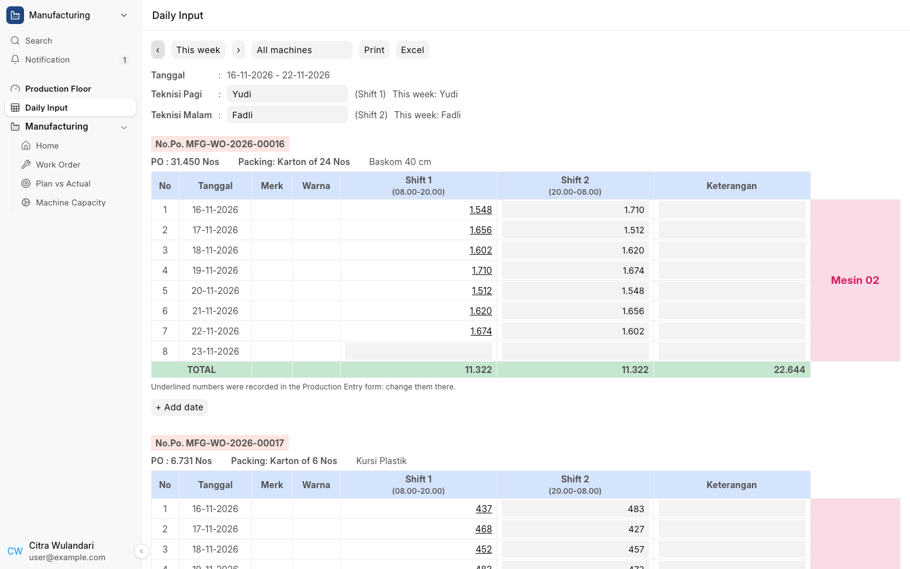

# Panduan Produksi

Untuk **Admin** (perkiraan, jadwal, resep, perintah produksi; hasil produksi cuma dilihat) dan **Produksi** (catat
hasil produksi, lihat Work Order dan Plan vs Actual; `user.md`). **Sales History** juga ada di menu **Selling**.
Alurnya:

1. sekali per produk: **lama produksi** dan **resep (BOM)**;
2. tiap bulan: **perkiraan penjualan → jadwal produksi → MRP → perintah produksi**;
3. tiap shift: **catat hasil produksi** per mesin (bagus lewat Daily Input; reject lewat form Production Entry);
4. tiap Senin: cek **Order Readiness** (Siap Order).

Ganti bahasa: klik nama kamu di pojok kiri bawah menu samping, pilih **Bahasa Indonesia**. Nama tombol di sini ditulis seperti
di tampilan bahasa Inggris.

## Lantai produksi (Production Floor)

Lihat 14 mesin injeksi sekaligus, sebagai gambar 3D, dan statusnya saat ini. Buka dari **Manufacturing → Production
Floor** (pilihan paling atas).

- **Warna lampu mesin**: hijau = jalan (Production), merah berkedip = Problem, biru dan agak gelap = Maintenance,
  mati dan lebih gelap = Off. Di atas tiap mesin ada nama dan Work Order yang sedang jalan.
- **Lihat dari sudut lain**: tarik pakai mouse untuk memutar, scroll untuk zoom, klik kanan lalu tarik untuk
  menggeser. Tombol **+**, **−** dan **rumah** (pojok kanan bawah) zoom dan mengembalikan tampilan awal.
- **Kembali**: tombol panah di pojok kiri atas membuka halaman depan Manufacturing, tanpa tombol Back browser.
- **Bar atas**: nama perusahaan, jam, dan titik **Live** (hijau = langsung ikut berubah; kalau tertulis
  **Updated jam:menit**, halamannya menyegarkan diri tiap menit). Kartu di bawahnya: jumlah mesin, yang jalan,
  yang bermasalah, Work Order yang jalan, dan hasil produksi.
- **Tabel mesin** (kiri atas, tepat di bawah bar atas): klik satu baris, kamera terbang ke mesin itu. Panah di kanan atasnya melipat tabel.
- **Perlu perhatian** (di bawah tabel mesin): mesin yang tidak sedang Production, yang paling parah di atas (Problem, Maintenance, Setup, Idle, Off), lengkap dengan Work Order-nya. Klik satu baris untuk terbang ke mesinnya. Kalau semua jalan tertulis **Semua mesin berjalan**. Di HP daftar ini terlipat dulu; ketuk judulnya untuk membukanya.
- **Layar memuat**: sebentar setelah halaman dibuka muncul kartu **Memuat lantai produksi…** sampai data dan gambar pertama siap.
- **Yang disimulasikan**: operator dan teknisi, suku cadang yang jatuh, dan isi tong hanyalah animasi (bukan data). Zona beserta isinya hanya dekorasi. Cincin di lantai mengikuti warna status mesin.
- **Tampilan gelap**: gedung, truk, dan tulisan di lantai ikut menjadi gelap kalau Desk dipasang ke tema gelap.
- **Klik satu mesin**: panel di kanan menunjukkan detailnya dan link ke Work Order-nya. Enam tombol status mengubah
  status mesin itu (sama dengan mengubah **Status** di formulir Workstation-nya); **Open machine** membuka
  formulirnya. Produksi cuma bisa lewat tombol ini; formulir Workstation cuma bisa dilihat.
- **Work Order di mesin mana?** Isi **Machine** di Work Order. Tanpa itu Work Order tidak muncul di lantai.
  Mesin yang tidak dipakai (1, 7, 9-13: Disabled, status Off) tidak bisa dipilih untuk Work Order baru; tetap
  tampil di lantai sebagai Off. Statusnya juga tidak bisa diganti lewat tombol di panel: muncul catatan "Mesin NN
  tidak aktif. Admin bisa mengaktifkannya di Workstation-nya." Admin mengaktifkan mesin dengan menghapus centang
  **Disabled** di Workstation-nya.
- **Mesin yang boleh untuk satu barang**: daftar pilihan **Machine** di Work Order hanya berisi mesin yang
  tercantum di **Machine Capacity** untuk barang itu. Memilih mesin lain ditolak: "X tidak dibuat di Y. Mesin untuk
  barang ini: ...". Barang yang belum punya baris Machine Capacity boleh di mesin mana saja; di bawah kolom
  **Machine** tertulis "Belum ada baris Machine Capacity untuk barang ini: semua mesin boleh." Work Order yang
  sudah jalan di mesinnya tetap jalan. Mau menambah mesin untuk barang itu: tambah baris di Machine Capacity dulu.
- **Seal Cap**: Work Order yang dibuat dari Sales Order (**Create → Work Order**) ikut memakai mesin di baris
  pesanan (Mesin 04 atau 14, harganya beda). Lewat **Production Plan**, jangan gabungkan baris Seal Cap dari mesin
  yang berbeda (jangan centang "Consolidate Sales Order Items"): Work Order gabungan hanya membawa satu mesin.
  Cek **Machine** di setiap Work Order Seal Cap sebelum Submit. Hasilnya baru bisa dicatat kalau `BB-SEAL-CAP`, pigmen
  warnanya, plastik (35x50 atau 30x45) dan Karung ada stoknya di Gudang Bahan Baku (`gudang.md`).
- Kalau browser tidak bisa menampilkan 3D, halaman menampilkan tabel biasa dengan isi yang sama.

## Sekali per produk

### Lama produksi (Item Lead Time)
1. **Manufacturing → Item Lead Time → + Add Item Lead Time**, pilih **Item** (produknya).
2. Isi **Capacity per Day**: berapa buah yang jadi sehari (semua mesin untuk produk itu).
3. Isi **Buffer Time**: hari cadangan (setting mesin, kirim ke gudang), misalnya `1`.
4. **Save**.

Tanpa lama produksi, Order Readiness menulis **Set lead time** dan tidak memberi tanggal mulai.

### Resep produk (BOM)
1. **Manufacturing → BOM → + Add BOM**, **Item** produknya, **Quantity** misalnya `1`.
2. Di **Items**: bahan dan jumlahnya untuk Quantity tadi, dalam satuan stok bahan (biji PP dalam Kg, kemasan dalam satuan stoknya, Buah atau
   Pcs). Contoh ember: `0,25` Kg biji PP dan `1` kemasan.
3. **Save**, **Submit**. BOM pertama otomatis jadi BOM utama (**Is Default**).

Produk yang punya baris **Machine Capacity** tidak perlu BOM manual: buka barisnya, klik **Make BOMs**. Sistem
membuat satu BOM per varian per mesin (biji plastik dan masterbatch dihitung dari berat produk dan runner), lalu
menonaktifkan BOM lama dari baris itu yang tidak dipakai Work Order yang masih jalan. BOM buatan tangan tidak diubah.

**Pigmen.** Varian berwarna (misalnya Merah) dapat baris pigmen tambahan kalau ada pigmen aktif untuk warna itu
(barang `PIGMEN` varian Merah). Jumlahnya dalam **gram** per buah: berat bahan per buah (kg) x **Pigment Ratio
(g per kg)** pigmen itu. Contoh: 50 g per buah = 0,05 kg x 2 g/kg = 0,1 g. Baris bahan baku tidak berkurang (pigmen
di atasnya). Warna tanpa pigmen (Bening, Bening Transparan, Campur, Neutral) tidak dapat baris. Pigmen baru, dinonaktifkan atau rasionya diubah:
sistem membuat ulang semua BOM dari Machine Capacity di belakang layar (BOM yang sudah benar tetap, Work Order yang
masih jalan tetap pakai BOM lamanya).

Pigmen baru (Admin): **Stock → Item → + Add Item**, atau buka barang **PIGMEN** → **Create → Variant**, pilih
**Warna**, isi **Pigment Ratio (g per kg)** (lebih dari 0, bawaan 1). Stoknya dalam gram, belinya per Kg
(`pembelian.md`).

Stok dulu: begitu pigmen dibuat, BOM warna itu langsung memakainya. Terima stoknya di **Gudang Bahan Baku**
(Material Receipt, `gudang.md`) sebelum Produksi mencatat hasil warna itu, kalau tidak pencatatan gagal (stok tidak
boleh minus). Setelah Save, sistem memberi catatan oranye kalau pigmennya belum ada stok di Gudang Bahan Baku.

**Kemasan.** Tiap baris tabel **Packing** di barang produk (punya varian sendiri, atau dari templatenya) jadi satu
baris BOM: 1 / **Pieces per Packing** barang kemasan itu per buah. Contoh: plastik isi 560 = 0,001785714 plastik per
buah, jadi 1.120 buah memakai 2 plastik. Baris Packing diubah atau barang kemasan dinonaktifkan: BOM dibuat ulang
seperti pigmen. Cara mengisi tabelnya: `admin.md` "Kemasan per produk". Reject memakai bahan baku dan pigmennya, tapi tidak
memakai kemasan (reject digiling ulang, tidak dikemas). Barang kemasan harus distok dalam satuan yang boleh pecahan
(**Buah**); kemasan bersatuan Pcs ditolak di tabel Packing.

## Tiap bulan

### 1. Perkiraan penjualan (Sales Forecast)
1. **Manufacturing → Sales Forecast → + Add Sales Forecast**.
2. **Company**, **Frequency** `Monthly`, **From Date** tanggal 1 bulan depan, **Number of Periods** misalnya
   `1` (atau `3` untuk tiga bulan).
3. **Parent Warehouse**: gudang induk perusahaan (yang di atas lima gudang).
4. Pilih produknya di **Items** (kotak pilih banyak), **Save**.
5. Klik **Fill from History**. Tiap produk diisi rata-rata 3 bulan penuh terakhir (riwayat penjualan + pesanan
   yang sudah di-submit), dibulatkan ke atas. Pesannya menyebut bulan yang dipakai.
6. Produk yang **belum punya riwayat** disebut di pesan dan diisi `0`: ketik angkanya sendiri.
7. Cek semua angka (bulan ini ada promo? pelanggan baru?), ubah kalau perlu, **Save**, **Submit**.

### 2. Jadwal produksi induk (Master Production Schedule)
Di Sales Forecast yang sudah di-submit: **Create → Master Production Schedule**. Kalau mau, tambahkan pesanan
terbuka di tab Sales Orders (**Get Sales Orders**) lalu **Get Actual Demand**. **Save**.

### 3. MRP
**Manufacturing → MRP** (Material Requirements Planning Report). Isi **MPS** dengan jadwal tadi (tanggalnya terisi
sendiri) dan **Warehouse** gudang induk perusahaan. Laporan menunjukkan berapa yang harus dibuat dan bahan yang harus
dibeli, per hari. Centang baris yang mau dibuat, klik **Make Purchase / Work Order**.

### 4. Perintah produksi (Work Order, Admin)
Gudang terisi sendiri: bahan dari Gudang Bahan Baku, proses di Gudang Produksi, hasil ke Gudang Barang Jadi.
1. Buka Work Order-nya, **Submit**. Work Order baru otomatis mencentang **Skip Material Transfer to WIP**: bahan
   diambil dari Gudang Bahan Baku saat hasil dicatat, jadi Produksi tidak perlu menunggu **Start**.
2. **Start** (Material Transfer for Manufacture) tidak wajib: cuma untuk Work Order yang centang tadi dihapus Admin.
3. Hasil produksi dicatat Produksi lewat **Input harian** (di bawah, halaman **Daily Input**), bukan
   lewat **Finish**. Tombol **Finish** cuma muncul untuk **Super Admin**; Manufacture yang tidak dibuat Production
   Entry ditolak ("Record output in Daily Input."), supaya semua hasil masuk ke Plan vs Actual.

## Input harian
Halaman **Daily Input** (menu paling atas, di bawah Production Floor) adalah lembar Excel harian Samuel: satu kotak
per Work Order, satu baris per tanggal, satu kolom per shift. Diisi **Produksi** (petugas pabrik) dari catatan
operator; Admin melihat halaman yang sama tanpa kotak isian.

- **Atas**: minggu (‹, **This week**, ›), filter mesin, **Tanggal** minggu itu, **Teknisi Pagi** (Shift 1) dan
  **Teknisi Malam** (Shift 2). Nama teknisi terisi nama terakhir yang dipakai; ganti kalau orangnya lain, nama itu
  ditulis di setiap angka yang disimpan sesudahnya.
- **Kotak Work Order**: No.Po. (nomor PO pelanggan, atau nomor Work Order), PO (jumlah pesanan), Packing (isi per
  Pack/Karton/Karung), mesin di kanan (pink), **CLOSE/DONE** kuning kalau Work Order-nya Completed. Work Order yang
  masih jalan selalu tampil; yang sudah selesai hanya di minggu hasil terakhirnya.
- **Baris**: semua tanggal yang sudah ada hasilnya, plus baris hari ini. **+ Add date** menambah tanggal lain (dari
  tanggal Work Order dibuat sampai hari ini).
- **Isi angka** barang bagus di kolom **Shift 1** atau **Shift 2** (boleh pakai titik, misalnya 13.384), lalu **Enter**
  atau **Tab**: tersimpan begitu pindah kotak, TOTAL ikut berubah. Ganti angka = hasil lama dibatalkan dan diganti;
  kosongkan (atau 0) = hasilnya dibatalkan. **Keterangan** tersimpan dengan cara yang sama (harus sudah ada angka di
  tanggal itu).
- **Salah ketik di Work Order yang sudah CLOSE/DONE?** Angkanya tetap bisa diganti: hasil lama dibatalkan, Work
  Order kembali In Process, lalu angka baru dicatat. Tanggal baru tidak bisa ditambah di Work Order yang sudah selesai.
- **Ditolak?** Pesannya muncul merah di bawah kotaknya dan angka yang diketik tetap ada: tanggal di masa depan, Work
  Order sudah berhenti atau ditutup, lebih dari yang boleh dibuat, atau mesin belum diisi ("No machine yet: Admin sets it on the
  Work Order.").
- **Angka bergaris bawah** dicatat lewat form Production Entry (ada reject, lebih dari satu entri, atau jam jalan lain):
  klik angkanya dan ubah di form itu.
- Tombol **Record Output** di Work Order membuka halaman ini langsung di kotak Work Order itu (**Show all** untuk
  semua).
- **Print** dan **Excel** (di atas, sebelah filter mesin; Produksi dan Admin sama-sama bisa) mengeluarkan semua kotak
  minggu yang tampil dengan susunan yang sama seperti lembar Samuel: **Print** membuka halaman cetak A4 mendatar di
  jendela baru (izinkan pop-up kalau diminta), **Excel** mengunduh `input-harian-<dari>-<sampai>.xlsx` (biru untuk
  judul kolom, hijau untuk TOTAL, pink untuk mesin, kuning untuk CLOSE/DONE; angka berformat ribuan, tanggal seperti
  `11-Nov-26`). Filter mesin di layar tidak ikut: yang keluar selalu semua mesin di minggu itu.

Di belakang layar setiap kotak yang terisi adalah satu **Production Entry** (Hasil Produksi), dengan stok yang bergerak
sendiri (tabel di bawah).

### Lewat form Production Entry (reject)
Reject tidak ada di Daily Input. Kalau perlu mencatat reject: **Manufacturing → Production Entry** lewat URL
`/desk/production-entry` (tidak ada di menu lagi), **+ Add Production Entry**, lalu:

1. Pilih **Work Order**. **Item**, **Machine** dan **Company** terisi sendiri dari Work Order.
2. **Date**: tanggal shift-nya (tidak boleh besok). **Shift**: salah satu shift yang diatur untuk pabrik (dua
   shift, masing-masing 12 jam). **Run Hours** terisi panjang shift itu; ganti kalau mesin cuma jalan sebagian.
3. **Good Qty**: jumlah barang bagus, angka bulat (Good Qty, Reject Qty dan jumlah reject tampil tanpa koma).
4. **Rejects**: satu baris per alasan (**Reason**, misalnya Short Shot, Flashing, Bubble) dan jumlahnya. **Reject
   Qty** dijumlah sendiri.
5. **Save**, **Submit**.

Saat Submit stok bergerak sendiri (dua Stock Entry, kelihatan di bagian **Stock Entries**):

| Yang terjadi | Ke mana |
|---|---|
| Barang bagus | Gudang Barang Jadi, dan dihitung ke **Produced Qty** Work Order |
| Barang reject | Gudang Reject (barangnya sama), **tidak** dihitung ke Work Order |
| Bahan untuk barang bagus | sesuai BOM, dari Gudang Produksi kalau Work Order-nya memakai transfer (bahan harus di-**Start** dulu); kalau Work Order melewati transfer, dari Gudang Bahan Baku |
| Bahan untuk barang reject | sesuai BOM, selalu dari **Gudang Bahan Baku** (bahan yang sudah ditransfer tetap utuh untuk barang bagus) |

Jadi Work Order baru **Completed** kalau barang **bagus**-nya sudah cukup; reject tidak ikut menghitung.

Ditolak kalau: mesinnya beda dengan mesin di Work Order (ganti dulu mesin di Work Order, boleh juga setelah di-Submit selama
Work Order-nya Not Started atau In Process), bagus dan reject
dua-duanya 0, ada baris reject 0, tanggal di masa depan, jam jalan 0 atau lebih dari 24, Work Order belum di-submit
atau sudah selesai/berhenti, atau alasan reject-nya sudah dinonaktifkan. Bahan kurang di gudang: Submit gagal dan
tidak ada stok yang berubah. Work Order yang di-**Stop** tidak bisa di-Cancel hasilnya: **Re-open** dulu Work Order-nya.

Salah isi? Buka Production Entry-nya, **Cancel** (kedua Stock Entry ikut batal, stok kembali), lalu **Amend** dan
perbaiki. Stock Entry-nya tidak bisa di-Cancel sendiri ("Cancel Production Entry ... instead.").

Daftar alasan reject: **Settings → Reject Reason** (Admin). Tambah alasan baru di sana; alasan yang tidak dipakai lagi
cukup dicentang **Disabled**, jangan dihapus.

## Tiap Senin: Order Readiness (Siap Order, Admin)

**Manufacturing → Order Readiness** Satu baris per produk jadi (per varian, misalnya per warna; template seperti "BASKOM-20" tidak ikut karena tidak pernah distok atau dijual), untuk bulan yang dipilih:

Pilih Company dan (kalau perlu) Warehouse milik company itu. Kalau muncul izin ditolak atau "Warehouse ... does
not belong to company", akunmu tidak boleh buka company atau gudang itu.

| Kolom | Artinya |
|---|---|
| Stock | stok di Gudang Barang Jadi + Gudang Pluit (kalau gudang tidak dipilih); angkanya merah kalau 0 atau kurang, oranye kalau di bawah Safety Stock, hijau kalau aman |
| Open Orders | pesanan yang belum dikirim |
| Forecast This Month | angka perkiraan bulan ini |
| Ordered This Month | yang sudah dipesan bulan ini |
| In Production | Work Order yang belum selesai |
| Short | yang masih kurang dan harus dibuat |
| Latest Start | paling lambat mulai produksi tanggal ini |

Status, yang paling mendesak di atas:

- **Late**: tanggal mulai sudah lewat, langsung buat Work Order;
- **Start this week**: mulai dalam 7 hari;
- **Set lead time**: produk belum punya Item Lead Time, isi dulu;
- **Scheduled**: masih ada waktu;
- **OK**: stok dan produksi cukup.

## Laporan Plan vs Actual

**Manufacturing → Plan vs Actual** membandingkan rencana dengan hasil yang dicatat lewat Production Entry.

Isi filter: Company, From Date dan To Date (otomatis 7 hari yang berakhir kemarin). Mesin, Item (pilih template, semua
variannya ikut), Work Order dan Shift boleh dikosongkan. Hanya Production Entry yang sudah **Submit** yang dihitung.

**Group by** mengatur baris: Machine, Machine + Day (bawaan), Day, Item, Work Order atau Shift. Angkanya dihitung dari
mesin × hari × Work Order × shift, lalu dijumlahkan sesuai pilihan.

**Target from** menentukan dari mana target datang:

- **Work Order** (bawaan): jumlah Work Order dibagi rata ke hari rencananya (Planned Start sampai Planned End, kalau
  kosong sampai Expected Delivery; kalau dua-duanya kosong, semua di hari mulai). Target masuk ke mesin di Work Order;
  Mengganti **Machine** di Work Order yang sudah di-Submit memindahkan seluruh targetnya (hari-hari yang sudah lewat
  juga) ke mesin yang baru. Mesin cuma bisa diganti selama Work Order-nya Not Started atau In Process; sesudah
  Completed, Stopped atau Closed kolom **Machine** terkunci. Work Order tidak bisa dipindah ke mesin yang tidak dipakai; yang sudah jalan di mesin itu dibiarkan. Work Order tanpa mesin masuk baris **No machine** (hasilnya tetap tampil di mesin yang mencatat). Kalau dikelompokkan
  per Shift, target hari itu dibagi menurut jam jalan yang dicatat di tiap shift; hari tanpa catatan dibagi rata ke
  semua shift pabrik.
- **Capacity**: pcs per jam dari Machine Capacity × jam jalan di Production Entry. Pasangan item-mesin tanpa data
  kapasitas tidak punya target: kolom Note menulis **No capacity** dan Achieved % kosong. Hari rencana tanpa catatan
  hasil bertarget 0.

| Kolom | Artinya |
|---|---|
| Target | rencana (kosong kalau tidak ada) |
| Good / Reject | jumlah bagus dan reject yang dicatat |
| Reject % | reject ÷ (bagus + reject) |
| Achieved % | bagus ÷ target: **hijau** mulai 100 %, **oranye** mulai 85 %, **merah** di bawahnya |
| (nama alasan) | satu kolom per alasan reject yang muncul di hasil |

Hari yang punya target tetapi belum ada hasil tetap muncul: bagus 0, Achieved % 0. Grafik batang di atas tabel
menampilkan Target, Good dan Reject per baris. Kalau muncul izin ditolak, akunmu tidak boleh buka company itu.
